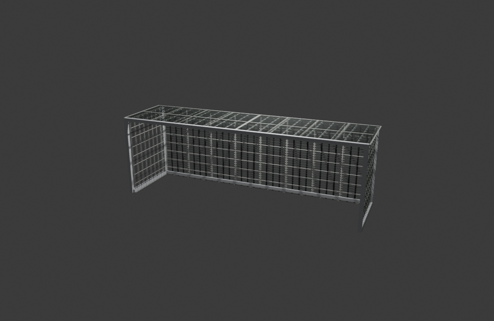
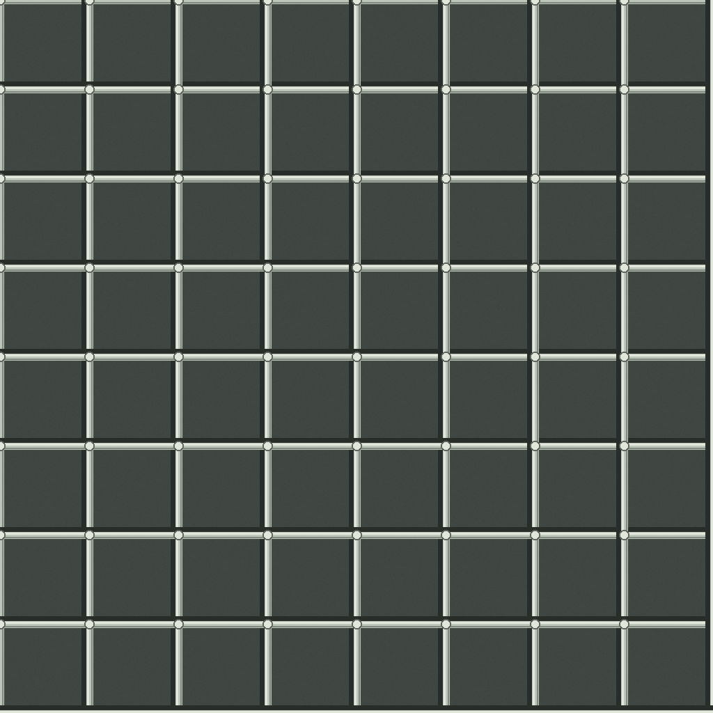
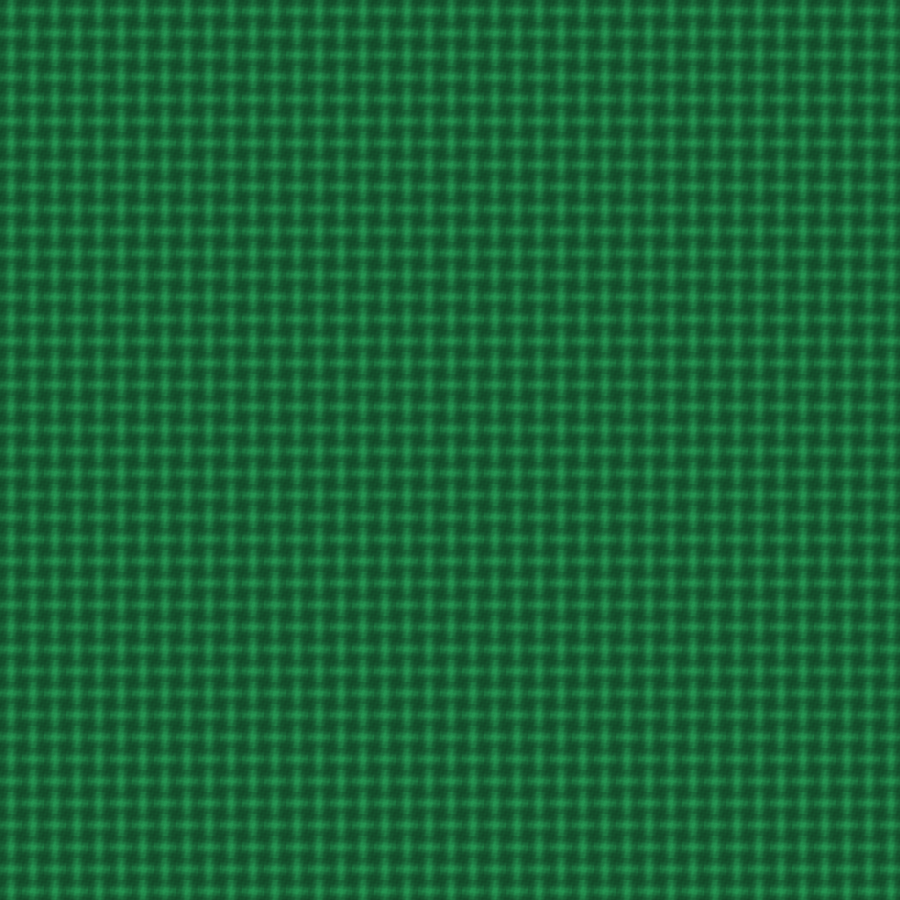
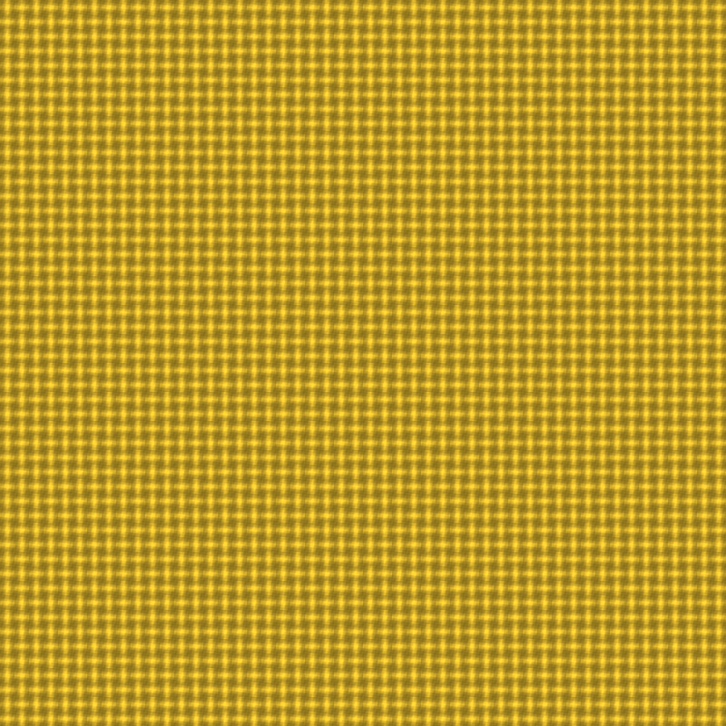

# Documentación de modelos texturizados

**Alumno:** Uriel Guerrero  
**Programa:** Blender 5.2.2 LTS

Este documento reúne la portería y el modelo descargado del jugador y el árbitro. Se explica cómo asignar sus materiales desde la interfaz de Blender, sin usar código.

También incluye el iluminador de estadio creado en Blender y los materiales aplicados a su estructura y paneles.

## 1. Portería de fútbol

A los postes y al marco se les asignó un material blanco esmaltado. Para la red se preparó una imagen de patrón de malla y se conectó como color base de su material.

### Textura de la red

### Pasos en Blender

1. En **Object Mode**, seleccioné las piezas del marco y los postes desde el **Outliner**.
2. En **Material Properties**, creé y asigné el material `Estructura | aluminio esmaltado`, con color blanco frío y rugosidad aproximada de 0.26.
3. Seleccioné las piezas de la red, identificables por el modificador **Wireframe**, y abrí **Shading**.
4. En el **Shader Editor**, agregué **Image Texture**, abrí `textura_red_nylon.png` y conecté **Color** a **Base Color** de **Principled BSDF**.
5. Revisé el resultado en **Material Preview** y guardé el proyecto con los recursos empaquetados.

**Autoría:** Modelo y materiales: Uriel Guerrero.

## 2. Jugador de fútbol

El modelo descargado ya presenta el uniforme verde, pantalón blanco y medias rojas mediante materiales de color. Se agregó un mapa normal de tejido al material verde del torso, conservando su color base.

**Imagen fuente del mapa normal:** [Cotton Jersey (Poly Haven)](https://polyhaven.com/a/cotton_jersey). El mapa técnico se incluye como `Cotton_Jersey_Normal.jpg`. La muestra verde es una ilustración de tejido para mostrar el aspecto y color previstos en la camiseta.

### Pasos realizados en Blender, sin código

1. En **Shading**, seleccioné el torso (`Jugador CHICHARITO torso`) y el material de la camiseta (`Verde selección mexicana`).
2. En el **Shader Editor**, agregué **Image Texture** y cargué `Cotton_Jersey_Normal.jpg` con **Open**.
3. Cambié **Color Space** a **Non-Color**.
4. Agregué **Normal Map**. Conecté **Color** de Image Texture a **Color** de Normal Map, y **Normal** de Normal Map a **Normal** de Principled BSDF.
5. Conservé el color base verde. El mapa de relieve se aplicó al torso; los brazos y hombros no se modificaron.

## 3. Árbitro

El modelo descargado ya presenta camiseta amarilla y pantalón oscuro mediante materiales de color. Se agregó un mapa normal de tejido deportivo al material amarillo del torso, conservando su color base. El relieve fino se aprecia en la vista de material de Blender.

**Imagen fuente del mapa normal:** [Jogging Melange (Poly Haven)](https://polyhaven.com/a/jogging_melange). El mapa técnico se incluye como `Jogging_Melange_Normal.jpg`. La muestra amarilla es una ilustración de tejido para mostrar el aspecto y color previstos en la camiseta.

### Pasos realizados en Blender, sin código

1. En **Shading**, seleccioné el torso (`Arbitro torso`) y el material de camiseta (`Amarillo árbitro`).
2. Agregué **Image Texture**, pulsé **Open** y cargué `Jogging_Melange_Normal.jpg`.
3. Cambié **Color Space** a **Non-Color** y agregué **Normal Map**.
4. Conecté **Color** de Image Texture a **Color** de Normal Map, y **Normal** de Normal Map a **Normal** de Principled BSDF.
5. Conservé el amarillo como color base. El mapa de relieve se aplicó al torso; los brazos y hombros no se modificaron.

## 4. Iluminador de estadio

Se creó un iluminador inspirado en una luminaria de cancha: base, mástil vertical, dos soportes inclinados y un cabezal rectangular con 16 paneles LED en una cuadrícula de 4 × 4. La estructura usa un acabado azul grafito oscuro (`Material.001`) y los paneles un tono marfil cálido (`Material.002`) con emisión cálida.

### Pasos realizados en Blender

1. Abrí un archivo nuevo con la plantilla **General** y construí la base, el mástil, los dos soportes laterales y la carcasa con primitivas **Cylinder** y **Cube**, ajustando su escala, posición y rotación desde la vista 3D.
2. Dupliqué los bloques pequeños para formar una cuadrícula de 16 paneles en el frente del cabezal.
3. En **Material Properties**, creé `Material.001`, le di el color grafito `46515C` y lo asigné a la base, el mástil y la carcasa.
4. Creé `Material.002` para los paneles LED, con color base marfil `FFF1C2`.
5. En la sección **Emission** de `Material.002`, usé el mismo tono cálido y una intensidad (**Strength**) de `3.0` para que los paneles representen fuentes de luz.
6. Revisé el resultado en **Material Preview** y guardé el archivo como `Iluminador_Estadio.blend` dentro de `modelos-uriel/`.
7. Asigné `Material.001` a los dos soportes inclinados (`Cylinder.001` y `Cylinder.002`) desde el selector de materiales para que coincidan con el mástil y la carcasa.

**Autoría:** Modelado y materiales: Uriel Guerrero.

## Guardar los modelos

La copia de los personajes está guardada como `JUGADOR_ARBITRO_TEXTURIZADOS.blend` en `modelos-uriel/`. Se usó **File > External Data > Pack Resources** y se guardó de nuevo para incluir las imágenes en el archivo. Para la portería, el proyecto correspondiente es `Porteria_texturizada.blend`, también en `modelos-uriel/`.

El iluminador de estadio está guardado como `Iluminador_Estadio.blend` en `modelos-uriel/`.

## Modelos Blender

- [Portería texturizada](../Porteria_texturizada.blend)
- [Jugador y árbitro texturizados](../JUGADOR_ARBITRO_TEXTURIZADOS.blend)
- [Iluminador de estadio texturizado](../Iluminador_Estadio.blend)

## Modelos base, antes del texturizado

- [Portería base](../modelos%20base/Porteria.blend)
- [Jugador y árbitro base](../modelos%20base/JUGADOR%20Y%20ARBITRO.blend)

La versión base del iluminador de estadio aún está pendiente de agregar.

